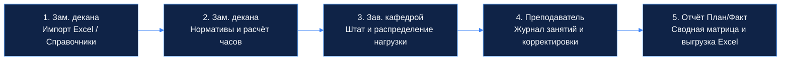

<div align="center">
  
  <br><br>
  <p>
    
    
    
    
    
  </p>
</div>

<br>


 **S.C.A.L.E (Staff Curriculum & Allocation Ledger Engine)** — веб-платформа для автоматизации учёта, расчёта и распределения учебной нагрузки между преподавателями кафедр, ведения электронного журнала занятий и план-фактного анализа выполнения поручений.

Система спроектирована вокруг трёх ключевых ролей учебного процесса — **заместителя декана**, **заведующего кафедрой** и **преподавателя** — и предоставляет каждой роли собственное рабочее пространство в едином строгом веб-интерфейсе без необходимости работать через стандартную панель Django Admin.

| Модуль платформы | Назначение и ключевой функционал |
| :--- | :--- |
| **Веб-интерфейс деканата** | Управление специальностями, кафедрами, академическими группами, учебными планами и дисциплинами в едином стеклянном UI (`/dean/`). |
| **Импорт из Excel (`.xlsx`)** | Автоматическое распознавание специальностей, курсов, групп, подгрупп и дисциплин с мгновенным расчётом часов нагрузки кафедры (`/data-import/`). |
| **Нормативы и лимиты** | Настраиваемые коэффициенты часов на студента/группу (экзамены, консультации, зачёты, УСР, КР) и годовые лимиты по должностям (`/settings/`). |
| **Распределение (HTMX)** | Назначение преподавателей на элементы нагрузки с живым пересчётом суммарных часов, контролем перегрузки и подсветкой профильных специалистов (`/distribution/`). |
| **Журнал и отчёт «План / Факт»** | Учёт фактически проведённых часов (любые положительные дробные значения), внесение корректировок и матрица выполнения по месяцам с экспортом в Excel (`/report/`). |

<br>


Ниже представлена полная цепочка работы в  **S.C.A.L.E** от загрузки исходных учебных данных до получения годового отчёта по кафедре.




После входа под учётной записью заместителя декана (`deputy_dean`) открывается **Панель деканата** (`/dean/`). Наполнить систему исходными данными можно двумя способами:

1. **Быстрый импорт из Excel (`/data-import/`):**
   - Перейдите в раздел **«Импорт данных»**.
   - Укажите год начала учебного года для первого курса (например, `2026`), выберите существующую кафедру из списка или введите название новой кафедры.
   - Загрузите файл `.xlsx` с кафедральной нагрузкой (дисциплины, специальности, курсы, семестры, число студентов, групп и подгрупп, плановые часы лекций, практик, лабораторных, УСР, контрольных работ, экзамены и зачёты).
   - Система автоматически создаст специальности, учебные планы, сформирует читаемые номера академических групп (например, `26ПМ1д`), равномерно распределит студентов и рассчитает элементы нагрузки кафедры.
2. **Ручное управление через справочники деканата (`/dean/`):**
   - **Специальности (`/dean/specialties/`):** добавление и редактирование кодов, названий и аббревиатур специальностей.
   - **Кафедры (`/dean/departments/`):** создание кафедр и назначение заведующих.
   - **Группы (`/dean/groups/`):** настройка академических групп, численности студентов и количества лабораторных подгрупп.
   - **Планы (`/dean/curricula/`) и Дисциплины (`/dean/disciplines/`):** ведение учебных планов по годам набора и настройка часов по каждой дисциплине с привязкой групп.


1. Перейдите в раздел **«Параметры»** (`/settings/`).
2. Проверьте или скорректируйте глобальные нормативы расчёта (часы экзамена на студента, часы консультации на группу, зачёты, контроль УСР, контрольные работы, количество подгрупп по умолчанию).
3. В правой колонке **«Нормы по должностям»** заданы годовые лимиты часов (минимум/максимум на `1.0` ставки и минимум лекционной нагрузки) для профессора, доцента, старшего преподавателя и ассистента.
4. Нажмите **«Пересчитать нагрузку»** (для выбранной кафедры или для всех кафедр сразу) — система автоматически сформирует все элементы нагрузки (`LoadItem`).


После входа под учётной записью заведующего кафедрой (`head`):

1. **Управление преподавателями (`/teachers/`):**
   - Добавьте преподавателей кафедры или отредактируйте существующих: укажите ФИО, должность, долю ставки (например, `1.0`, `0.5`), учёную степень и звание, а также логин и пароль для входа в систему.
   - Отметьте **специализацию** преподавателя (профильные дисциплины) с помощью встроенного поиска по названию предмета.
2. **Распределение нагрузки (`/distribution/`):**
   - В левой части экрана отображаются все элементы нагрузки вашей кафедры, сгруппированные по специальностям (лекции на поток, практики на группу, лабораторные по подгруппам `26ПМ1д-1`, `26ПМ1д-2`, экзамены, зачёты, УСР, КР).
   - В выпадающем списке напротив каждого элемента выберите преподавателя. Преподаватели, у которых данная дисциплина входит в специализацию, отмечены галочкой `✓` и поднимаются в начало списка.
   - При выборе преподавателя правая панель **«Преподаватели»** мгновенно обновляется без перезагрузки страницы (через HTMX): отображаются набранные часы, индивидуальная норма с учётом ставки и цветовой статус (`В норме`, `Предупреждение`, `Критично` при перегрузке).
   - При необходимости скачайте готовое распределение кнопками **«Нагрузка Excel»** и **«Преподаватели Excel»**.


После входа под учётной записью преподавателя (`teacher`):

1. **Просмотр личной нагрузки (`/workload/`):**
   - Таблица показывает все назначенные преподавателю дисциплины с разбивкой по видам работ, отдельные итоги за **осенний семестр**, **весенний семестр** и **общий итог за год**, а также прогресс выполнения годовой нормы.
   - Доступна выгрузка личной карточки нагрузки в `.xlsx`.
2. **Ведение журнала занятий (`/journal/`):**
   - После проведения занятия преподаватель выбирает в форме справа дисциплину и вид работы, указывает дату, время (опционально), **любое положительное количество отработанных часов** (например, `2`, `1.5`, `0.25`) и тему занятия.
   - Все внесённые часы автоматически поступают в фактическое выполнение нагрузки за соответствующий месяц.


Раздел **«Отчёт»** (`/report/`) доступен всем ролям (преподаватель видит свою матрицу, заведующий кафедрой — сводку по всей кафедре или любому выбранному преподавателю, заместитель декана — по любой кафедре факультета):

- **Матрица «Месяц × Виды работ»:** в каждой ячейке отображается **факт** и под ним — **план** (плановые часы семестра равномерно распределяются по 5 учебным месяцам: сентябрь–январь и февраль–июнь).
- **Цветовая индикация:** итоговые ячейки подсвечиваются **красным** при недовыполнении плана и **зелёным** при перевыполнении.
- **Детализация по клику:** нажатие на любое число в таблице открывает модальное окно с расшифровкой по дисциплинам, преподавателям и причинам отклонений.
- **Добавление корректировок:** если занятие было перенесено, заменено или проведена дополнительная работа, в нижней карточке выбирается дисциплина, вид работы, месяц, вводится положительное количество часов и причина.
- **Экспорт отчёта в Excel:** кнопка **«Скачать Excel»** формирует книгу `.xlsx` с четырьмя листами: *«Факт»*, *«План»*, *«Отклонение»* и *«Корректировки»*.

<br>


| Логин | Пароль | Роль в системе | Основные разделы |
| :--- | :--- | :--- | :--- |
| **`deputy_dean`** | `pass123` | Заместитель декана | Деканат (`/dean/`), Специальности, Кафедры, Группы, Планы, Дисциплины, Параметры (`/settings/`), Импорт данных (`/data-import/`), Отчёт (`/report/`) |
| **`head`** | `pass123` | Заведующий кафедрой | Распределение (`/distribution/`), Преподаватели (`/teachers/`), Параметры (`/settings/`), Отчёт (`/report/`) |
| **`teacher`** | `pass123` | Преподаватель (Мария Петрова) | Моя нагрузка (`/workload/`), Журнал (`/journal/`), Отчёт (`/report/`) |

> [!TIP]
> Демонстрационный набор (`core/seed.py`) также создаёт дополнительных преподавателей реальных кафедр ФМиИТ ВГУ имени П. М. Машерова. Для создания суперпользователя Django (`/admin/`) выполните: `python manage.py createsuperuser`.

<br>


В корне проекта расположен скрипт автоустановки [`deploy.sh`](file:///d:/TutorSys/deploy.sh). Он за один запуск проверяет наличие Python 3, создаёт виртуальное окружение `.venv`, устанавливает зависимости, генерирует файл `.env` с криптостойким `SECRET_KEY`, накатывает миграции, заполняет базу демо-данными и запускает сервер.

### 1. Подключитесь к серверу по SSH и скачайте репозиторий

```bash
sudo apt-get update && sudo apt-get install -y git python3 python3-venv python3-pip
git clone https://github.com/KovidIvan/TutorSys.git
cd TutorSys
git checkout dev
chmod +x deploy.sh
```

### 2. Выберите режим запуска

#### Режим А (Рекомендуемый для VDS): Запуск как фоновый сервис `systemd` (работает 24/7)
Сервер продолжит работать после закрытия окна SSH-терминала и будет автоматически подниматься при перезагрузке VDS:

```bash
./deploy.sh --systemd
```

#### Режим Б: Обычный запуск в текущем окне терминала
Подходит для быстрой проверки (работает, пока открыта сессия терминала):

```bash
./deploy.sh
```

#### Дополнительные параметры `deploy.sh`
```bash
# Запуск с чистой базой без загрузки демо-данных:
./deploy.sh --no-seed

# Запуск на нестандартном порту (например, 8080 вместо 8000):
./deploy.sh --port=8080
```

> [!IMPORTANT]
> Если на вашем сервере VDSina активен файрвол `ufw`, разрешите входящие подключения к порту `8000`:
> ```bash
> sudo ufw allow 8000/tcp
> ```
> После запуска система доступна в браузере по адресу: `http://<IP_ВАШЕГО_СЕРВЕРА>:8000/accounts/login/`

<br>


Конфигурация [`Dockerfile`](file:///d:/TutorSys/Dockerfile) и [`docker-compose.yml`](file:///d:/TutorSys/docker-compose.yml) позволяет развернуть проект в изолированном контейнере без ручной установки Python и пакетов на хост-систему. База данных сохраняется в именованном Docker-томе `scale_data` и не теряется при перезапуске контейнера.

### 1. Установите Docker и Docker Compose (если ещё не установлены на сервере)

```bash
curl -fsSL https://get.docker.com | sudo sh
```

### 2. Склонируйте проект и соберите контейнер одной командой

```bash
git clone https://github.com/KovidIvan/TutorSys.git
cd TutorSys
git checkout dev
docker compose up -d --build
```

При первом старте контейнер автоматически:
1. Применит все миграции базы данных (`migrate --noinput`).
2. Загрузит демонстрационные данные (если база пуста).
3. Запустит веб-сервер на порту `8000`.

Проверка логов и состояния контейнера:
```bash
docker compose ps
docker compose logs -f
```

<br>


В корне проекта предусмотрен скрипт [`setup.ps1`](file:///d:/TutorSys/setup.ps1) для быстрого старта на Windows одной командой:

```powershell
.\setup.ps1
```

Параметры для PowerShell:
```powershell
# Запуск без заполнения демо-данными:
.\setup.ps1 -NoSeed

# Запуск на другом порту:
.\setup.ps1 -Port 8080
```

<br>


В процессе работы часто требуется либо полностью очистить базу данных от демо-записей перед загрузкой реального Excel-файла кафедры, либо, наоборот, заново накатить демонстрационные данные и стандартные аккаунты (`deputy_dean`, `head`, `teacher` с паролем `pass123`).

### 1. Сбросить БД и заново заполнить демо-данными (восстановить `deputy_dean`, `head`, `teacher`)

- **На личном сервере VDS (через `deploy.sh` или напрямую):**
  ```bash
  cd ~/TutorSys
  ./deploy.sh --reset-db
  ```
  *(или вручную через Python виртуального окружения):*
  ```bash
  cd ~/TutorSys && .venv/bin/python manage.py shell -c "from core.seed import run; run()"
  ```

- **В контейнере Docker:**
  ```bash
  docker compose exec web python manage.py shell -c "from core.seed import run; run()"
  ```

- **Локально на Windows (PowerShell):**
  ```powershell
  .\.venv\Scripts\python.exe manage.py shell -c "from core.seed import run; run()"
  ```

---

### 2. Полностью очистить БД до пустого состояния (удалить все таблицы и демо-аккаунты)

> [!WARNING]
> Полная очистка (`flush`) удаляет из базы **все записи, включая пользователей** `deputy_dean`, `head` и `teacher`. После полной очистки вы не сможете войти под демо-логинами, пока либо не создадите своего администратора (`createsuperuser`), либо снова не загрузите демо-набор (`--reset-db`).

- **На личном сервере VDS:**
  ```bash
  cd ~/TutorSys
  ./deploy.sh --clear-db
  # Или напрямую:
  .venv/bin/python manage.py flush --noinput
  ```
  Создание собственного администратора на пустой базе:
  ```bash
  .venv/bin/python manage.py createsuperuser
  ```

- **В контейнере Docker:**
  ```bash
  # Очистить все таблицы внутри работающего контейнера:
  docker compose exec web python manage.py flush --noinput

  # Создать суперпользователя на чистой базе в Docker:
  docker compose exec web python manage.py createsuperuser

  # Альтернатива: удалить сам том базы данных и пересоздать контейнер с нуля:
  docker compose down -v && docker compose up -d --build
  ```

- **Локально на Windows (PowerShell):**
  ```powershell
  .\.venv\Scripts\python.exe manage.py flush --noinput
  .\.venv\Scripts\python.exe manage.py createsuperuser
  ```

<br>


Чтобы приложение не оставалось висеть фоновым процессом и не занимало оперативную память или порт `8000`, используйте соответствующую вашему способу запуска команду:

### 1. Остановка процесса на Linux-сервере VDS (`deploy.sh` и `systemd`)

- **Универсальная команда одной строкой (останавливает и фоновый сервис `systemd`, и любой запущенный процесс `runserver`):**
  ```bash
  cd ~/TutorSys && ./deploy.sh --stop
  ```
- **Если сервер запущен прямо в открытом окне терминала (`./deploy.sh` без флага `--systemd`):**
  Нажмите комбинацию клавиш <kbd>Ctrl</kbd> + <kbd>C</kbd>. Если терминал был закрыт, а процесс остался в памяти, завершите его командой:
  ```bash
  pkill -f "manage.py runserver"
  ```
- **Управление фоновым сервисом `systemd` (`scale.service`):**
  ```bash
  # Посмотреть текущий статус и потребление памяти (RAM / CPU)
  sudo systemctl status scale.service

  # Перезапустить сервис (например, после git pull)
  sudo systemctl restart scale.service

  # Временно остановить сервис
  sudo systemctl stop scale.service

  # Отключить автозапуск сервиса при перезагрузке сервера
  sudo systemctl disable scale.service

  # Полностью удалить сервис из системы (опционально)
  sudo rm -f /etc/systemd/system/scale.service && sudo systemctl daemon-reload
  ```
- **Проверка, что порт `8000` свободен и в памяти сервера нет висящих процессов:**
  ```bash
  pgrep -af "manage.py runserver" || echo "Ни одного процесса не запущено"
  ```

### 2. Остановка контейнера в Docker (`Docker Compose`)

- **Временно поставить контейнер на паузу без удаления:**
  ```bash
  docker compose stop
  ```
- **Запустить остановленный контейнер снова:**
  ```bash
  docker compose start
  ```
- **Полностью остановить и выгрузить контейнер из памяти (база данных в томе `scale_data` сохраняется):**
  ```bash
  docker compose down
  ```
- **Полностью остановить контейнер и стереть том с базой данных:**
  ```bash
  docker compose down -v
  ```
- **Проверить, что в Docker не осталось запущенных контейнеров:**
  ```bash
  docker ps
  ```

### 3. Остановка на Windows (PowerShell)

Нажмите <kbd>Ctrl</kbd> + <kbd>C</kbd> в окне PowerShell, где запущен сервер.

<br>


### Переключение на СУБД PostgreSQL

По умолчанию проект работает на встроенной базе **SQLite** (`db.sqlite3`). Драйвер `psycopg[binary]` для **PostgreSQL** уже включён в `requirements.txt`.

Чтобы переключить проект на PostgreSQL, создайте базу данных и укажите параметры подключения в файле `.env` (PostgreSQL активируется автоматически, когда заполнены оба поля `DB_ENGINE` и `DB_NAME`):

```dotenv
SECRET_KEY=ваш-секретный-ключ
DEBUG=False
ALLOWED_HOSTS=ваш-домен.рф,IP-вашего-сервера,localhost,127.0.0.1

DB_ENGINE=django.db.backends.postgresql
DB_NAME=nagruzka
DB_USER=postgres
DB_PASSWORD=ваш-пароль
DB_HOST=localhost
DB_PORT=5432
```

После сохранения `.env` перезапустите проект (`./deploy.sh` или `sudo systemctl restart scale`).

---

### Формулы расчёта учебной нагрузки

Математическое ядро расчёта находится в модуле [`core/calculations.py`](file:///d:/TutorSys/core/calculations.py). Коэффициенты берутся из глобальной настройки `CalcSettings`:

| Вид учебной работы | Код | Формула расчёта часов | Примечание |
| :--- | :---: | :--- | :--- |
| **Лекции** | `lec` | $H_{\text{лек}} = \text{hours\_lec}$ | Создаётся **один элемент на весь поток** (все группы дисциплины) |
| **Практические занятия** | `pract` | $H_{\text{практ}} = \text{hours\_pract}$ | Создаётся **отдельно на каждую группу**, привязанную к дисциплине |
| **Лабораторные работы** | `lab` | $H_{\text{лаб}} = \text{hours\_lab}$ | Создаётся **на каждую подгруппу** (`1..N`) каждой группы дисциплины |
| **Экзамен + консультация** | `exam` | $H_{\text{экз}} = N_{\text{студ}} \times k_{\text{экз}} + H_{\text{конс}}$ | По умолчанию: $0.35\text{ ч} \times N_{\text{студ}} + 2.0\text{ ч}$ на каждую группу |
| **Зачёт** | `credit` | $H_{\text{зач}} = N_{\text{студ}} \times k_{\text{зач}}$ | По умолчанию: $0.25\text{ ч} \times N_{\text{студ}}$ на каждую группу |
| **Контроль УСР** | `usr` | $H_{\text{УСР}} = H_{\text{контр\_УСР}}$ | По умолчанию: $2.0\text{ ч}$ на группу (если у дисциплины $\text{hours\_usr} > 0$) |
| **Контрольные работы** | `kr` | $H_{\text{КР}} = N_{\text{студ}} \times N_{\text{КР}} \times k_{\text{КР}}$ | По умолчанию: $0.30\text{ ч} \times N_{\text{студ}} \times N_{\text{КР}}$ на каждую группу |

#### Распределение годовых норм и плана отчёта
- **Индивидуальная норма преподавателя:** рассчитывается как $\text{Норма должности} \times \text{Ставка}$ (`rate`), либо берётся из индивидуального переопределения (`override_min_hours` / `override_max_hours`).
- **Помесячное распределение плана в отчёте:** плановые часы нечётных (осенних) семестров равномерно делятся на **5 месяцев** (*сентябрь — январь*), чётных (весенних) семестров — на **5 месяцев** (*февраль — июнь*). В июле и августе плановая нагрузка равна нулю.
- **Фактическое выполнение за месяц:** сумма часов из журнала занятий (`JournalEntry`) и часов корректировок (`Adjustment`) за выбранный месяц и год.

---

### Структура репозитория

```text
TutorSys/
├── nagruzka/                  # Конфигурация проекта Django (settings, urls, wsgi/asgi)
├── core/
│   ├── models.py              # Модели данных (Специальности, Кафедры, Группы, Планы, Нагрузка, Журнал)
│   ├── calculations.py        # Алгоритмы расчёта нагрузки, проверки норм и матрицы План/Факт
│   ├── importers.py           # Парсер и валидатор Excel-таблиц кафедральной нагрузки
│   ├── forms.py               # Формы веб-интерфейса деканата
│   ├── views.py               # Контроллеры страниц, ролевой доступ и экспорт XLSX
│   ├── urls.py                # Маршрутизация приложения
│   ├── seed.py                # Демонстрационный набор данных факультета
│   ├── static/core/           # Локальные стили theme.css, SVG-графика, Bootstrap 5 и HTMX
│   └── templates/             # HTML-шаблоны (интерфейс деканата, кафедры, преподавателя и входа)
├── deploy.sh                  # Автоустановка, запуск и остановка на Linux-сервере (VDSina)
├── setup.ps1                  # Быстрый запуск одной командой на Windows (PowerShell)
├── Dockerfile                 # Сборка Docker-образа приложения
└── docker-compose.yml         # Оркестрация контейнера и тома базы данных
```
